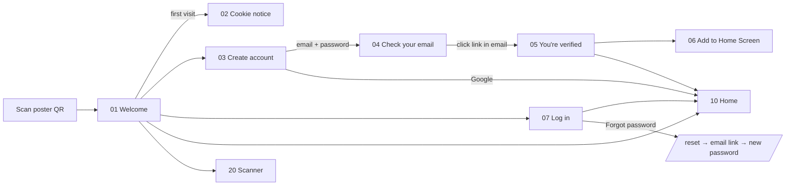
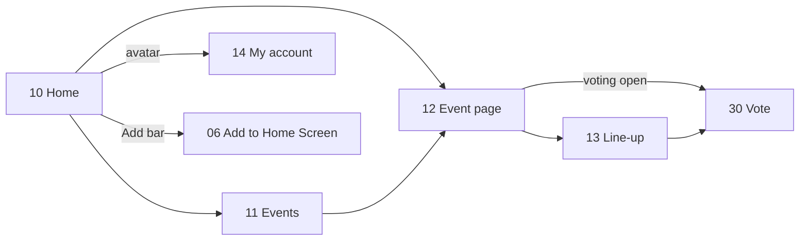
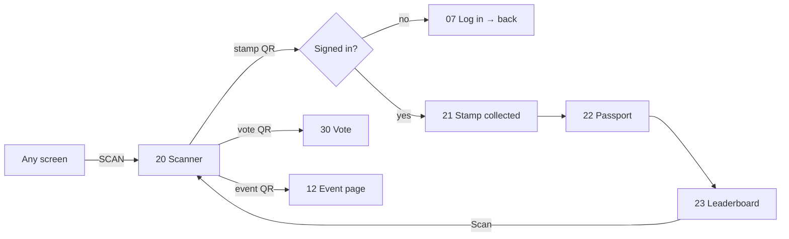
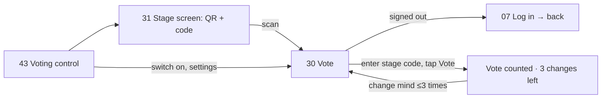
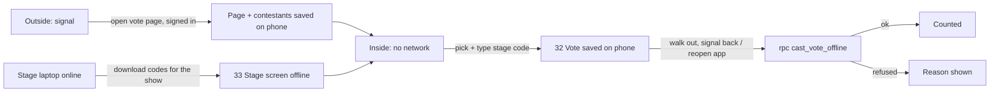
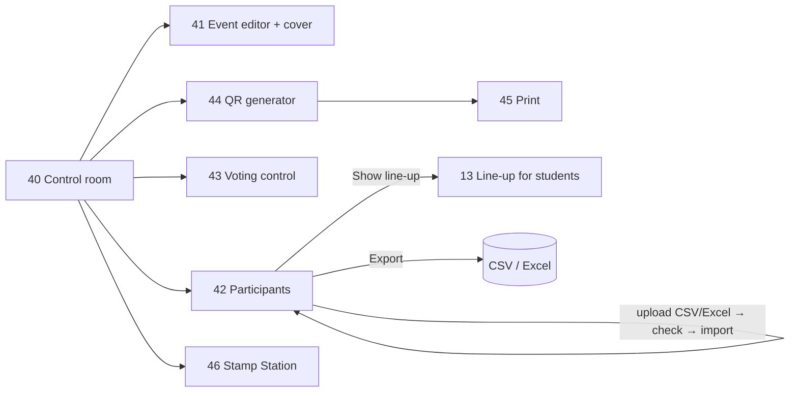
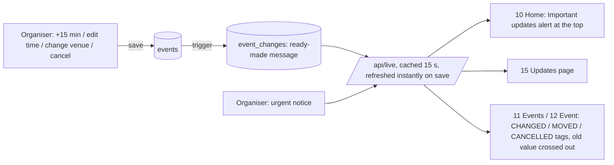

# Fest Live: complete app structure and screen flow

This is the map of the whole first launch: every screen, its route, who sees it, where each button goes, and the data behind it. Use it with the design files:

- `design/index.html`: open in a browser to see **all screens in flow order**. Click a screen to open it full size and tap through the app (links work from Welcome to voting).
- `design/png/*.png`: a screenshot of every screen. **Attach the matching PNGs to each Antigravity prompt.**
- `design/screens/*.html`: each screen as a standalone HTML file (exact colours, spacing, fonts and animations to copy).

Sample names and numbers in the designs are placeholders.

---

## 1. Navigation model

**Bottom bar (every main student screen):** Home · Events · **SCAN** (raised button in the middle) · Vote · Hunt

| Element | Where | Goes to |
| --- | --- | --- |
| Avatar (top right of Home) | Home | My account, or Welcome when signed out |
| SCAN button | Bottom bar, Events header, Welcome, Leaderboard | QR scanner |
| "Add Fest Live to your Home Screen" bar | Above the bottom bar, every visit in a browser tab | Add to Home Screen guide |
| Back arrow | Every detail screen | The screen it came from |

**Install = Add to Home Screen.** The app is never in the Play Store or App Store. It's a PWA: people add it to their home screen, it gets an icon and opens full screen. The bar shows on every visit while the site is open in a normal browser tab, and never once it runs from the home screen.

---

## 2. Screen catalogue

| ID | Screen | Route | Who | Main data | Buttons and links go to |
| --- | --- | --- | --- | --- | --- |
| 01 | Welcome (first open) | `/welcome` | Everyone, first visit | — | Create account → 03 · Log in → 07 · Just look around → 10 · Scan a QR → 20 |
| 02 | Cookie notice (sheet) | over 01/10 | Everyone, first visit | localStorage choice | Got it → closes · Privacy policy |
| 03 | Create account | `/signup` | Signed out | `auth.signUp` (name, email, password) | Create account → 04 · Google → 10 · Log in → 07 |
| 04 | Check your email | `/signup/check-email` | Just signed up | — | Open email app · Resend (60 s) · Change email → 03 |
| 05 | You're verified | `/auth/callback?next=/verified` | After clicking the link | `profiles.college_verified` | Add to Home Screen → 06 · Go to the fest → 10 |
| 06 | Add to Home Screen | sheet / `/install` | Browser visitors | `beforeinstallprompt`, display-mode | Add to Home Screen (Android) · iPhone steps · Maybe later |
| 07 | Log in | `/login` | Signed out | `auth.signInWithPassword`, Google | Log in → previous page or 10 · Forgot password → `/reset` · Create account → 03 |
| 10 | Home | `/` | Everyone | `/api/live` (now, next, **latest event changes + urgent notices**), open polls, my hunt summary | **Important updates alert (top) → 15** · Live card → 30 or 12 · Up next → 12 · Hunt card → 22 · Avatar → 14 · Add bar → 06 |
| 15 | Updates and notices | `/updates` | Everyone | `event_changes` + announcements | Change → 12 · tabs All / Changes / Notices |
| 11 | Events | `/events` | Everyone | events + venue + host + cover, poll/stamp flags | Card → 12 (or 30 when voting) · Scan → 20 · Tabs All/Live/Soon/Done · Search |
| 12 | Event page | `/events/[id]` | Everyone | event, host, cover, poll, stamp point, line-up count | Line-up → 13 · Vote (when open) → 30 · Calendar · Directions · Share · Contact host |
| 13 | Line-up | `/events/[id]/line-up` | Everyone | `participants_public` | Vote → 30 · Show all |
| 14 | My account | `/account` | Signed in | profile, stamps, rank, votes cast | Edit profile · Change password · Hide from leaderboard · Cookies → 02 · Add to Home Screen → 06 · Sign out · Delete account |
| 20 | QR scanner | `/scan` | Everyone (sign-in asked only when claiming) | camera | Stamp QR → 21 · Vote QR → 30 · Event QR → 12 · Enter code instead |
| 21 | Stamp collected | `/stamp/[pointId]?c=…` | Signed in | `rpc claim_stamp` | See my passport → 22 · What's on now → 10 |
| 22 | Stamp Hunt | `/hunt` | Everyone (passport when signed in) | stamp points, my stamps, top 10 | Full leaderboard → 23 · Scan → 20 |
| 23 | Leaderboard | `/hunt/leaderboard` | Everyone | `stamp_leaderboard` | Scan → 20 · Back → 22 |
| 30 | Audience vote | `/vote/[eventId]` | Everyone views; signed in votes | `poll_results`, my vote | Vote · stage code box · Back |
| 31 | Stage screen | `/screen/vote/[eventId]` | Volunteer/organiser device, projector | `poll_results`, `rpc get_vote_code` | — (display only) |
| 32 (later) | Vote saved offline | `/vote/[eventId]` (offline state) | Signed-in voters with no network | IndexedDB queue → `rpc cast_vote_offline` | Back to the fest → 10 |
| 33 (later) | Stage screen, offline mode | `/screen/vote/[eventId]` (offline state) | Stage laptop with no network | codes from `rpc get_vote_codes` stored in advance | — (display only) |
| 40 | Control room | `/admin` | Organiser | events now/next, stats | Tabs: Events · Participants → 42 · Voting → 43 · QR → 44 · Stations → 46 · New event / Edit → 41 |
| 41 | Event editor | `/admin/events/[id]` | Organiser | event + cover upload | Preview → 12 · Save and publish |
| 42 | Host: participants | `/host/events/[id]/participants` | Event host or organiser | `participants` (private fields) | Upload CSV/Excel · Import · Check in · Show line-up switch · Add · Export CSV/Excel |
| 43 | Voting control | `/admin/voting` | Organiser | polls, contestants, counts | On/off per competition · Settings · Stage screen → 31 · Close now · Fraud review · Export |
| 44 | QR generator | `/admin/qr` | Organiser | events, venues, polls, stamp points | Print · PNG · Copy link · All events |
| 45 | QR poster (A4) | `/admin/qr/print` | Organiser | — | Print |
| 46 | Stamp Station | `/admin/station/[pointId]` | Volunteer/organiser | `rpc get_live_code`, stamps count | — (display only, keeps screen on) |
| 90–94 | Signals, Raise a Signal, My schedule, Football, Scorer | — | **Later** | — | Not part of the first launch |

---

## 3. Flows

### 3.1 First open and account


### 3.2 Browse the fest


### 3.3 Scan and Stamp Hunt


### 3.4 Voting


### 3.4b Voting in a hall with no network (later: not used at this fest; auditorium voting is off)


### 3.5 Host and organiser


---

## 3.6 Change alerts (delays, time and venue changes, cancellations)

Rules: the Home alert shows changes and urgent notices from the **last 3 hours**, newest first (up to 2 lines plus "N more"); tapping opens 15. A student can dismiss it; it comes back when a **new** change arrives (remember the newest id seen, in localStorage). Changes older than 3 hours stay on the Updates page.

## 4. Roles

| Role | How they get it | Can do |
| --- | --- | --- |
| Visitor | Nobody signs in | Everything public: home, events, line-up, results, leaderboard, live vote results (when visible), scanner |
| Student | Signs up or logs in | + vote, Stamp Hunt, My account; **Verified** badge after confirming a college email |
| Host | Organiser adds them to an event (`event_hosts`) | + manage that event's participants (upload, check in, order, export, show/hide line-up) |
| Volunteer | Organiser sets `role = volunteer` | + run Stamp Stations and stage screens |
| Organiser | Admin sets `role = organiser` | + everything in the control room |
| Admin | Set in the Supabase dashboard | + make people organisers |

---

## 5. App structure (Next.js App Router)

```text
app/
  (public)/
    page.tsx                         10 Home
    updates/page.tsx                 15 Updates and notices
    welcome/page.tsx                 01 Welcome (+ 02 cookie sheet component)
    events/page.tsx                  11 Events
    events/[id]/page.tsx             12 Event page
    events/[id]/line-up/page.tsx     13 Line-up
    scan/page.tsx                    20 Scanner
    stamp/[pointId]/page.tsx         21 Stamp collected (claims on load)
    hunt/page.tsx                    22 Passport
    hunt/leaderboard/page.tsx        23 Leaderboard
    hunt/board/page.tsx              TV leaderboard (help desk)
    vote/page.tsx                    vote hub
    vote/[eventId]/page.tsx          30 Audience vote
    install/page.tsx                 06 Add to Home Screen (also a sheet)
  (auth)/
    signup/page.tsx                  03
    signup/check-email/page.tsx      04
    login/page.tsx                   07
    reset/page.tsx, reset/new/page.tsx
    verified/page.tsx                05
  auth/callback/route.ts
  account/page.tsx                   14
  screen/vote/[eventId]/page.tsx     31 (no nav)
  admin/
    page.tsx                         40
    events/[id]/page.tsx             41 (and /admin/events/new)
    voting/page.tsx                  43
    qr/page.tsx, qr/print/page.tsx   44, 45
    station/[pointId]/page.tsx       46
    import/page.tsx, stats/page.tsx, emergency/page.tsx
  host/events/[id]/participants/page.tsx   42
  api/live/route.ts, api/vote/[eventId]/route.ts, api/health/route.ts
components/  BottomNav (with raised Scan), AddToHomeBar, CookieSheet, EventCard, CoverImage,
             StatusChip, Mascot (SVG + CSS animation), QrScanner, QrCard, PodiumLeaderboard, VoteCard
lib/         supabase/{public,server,client,admin}.ts, data/*, time.ts, resilience.ts, snapshot.ts, validation.ts
supabase/    schema.sql, storage.sql, schema_participants.sql, schema_voting.sql, schema_stamps.sql, seed.sql
public/      manifest icons, campus-map.jpg (optional), schedule.json (built)
```

**Database install order:** `schema.sql` → `schema_changes.sql` → `storage.sql` → `schema_participants.sql` → `schema_voting.sql` → `schema_stamps.sql` (hunt only) → `seed.sql` (development only).

---

## 6. States every screen must handle

| State | What to show |
| --- | --- |
| Loading | Skeletons in the same shape as the content (never a blank screen) |
| Empty | Friendly line + next step (e.g. "No line-up yet. The host will publish it soon.") |
| Offline / backup mode | Last saved data + "Offline · updated 2 min ago" or "Running in backup mode" |
| Not signed in (vote, stamp) | Short reason + Log in / Create account, then return to the same screen |
| Errors from voting/stamps | The friendly message from the database result (`reason`) |
| Camera blocked (scanner) | Steps to allow the camera + "Enter a code instead" |
| Reduced motion | All mascot and bar animations off |

---

## 7. Host participants: file format

Upload CSV or Excel (`.xlsx`). The first row is the header. Columns (any order, case-insensitive):

| Column | Required | Shown to students |
| --- | --- | --- |
| name | yes | yes |
| team | no | yes |
| college | no | yes |
| department | no | yes |
| email | recommended (used to match re-uploads) | **no** |
| phone | no | **no** |
| order | no (performance order) | yes |

Template: `templates/participants_template.csv`. **Fiesta'26 registrations come from Google Forms:** the host opens the form's responses → Google Sheets → File → Download → CSV or Excel, and uploads that file directly; the importer recognises common Google Forms headers (Full Name, Email Address, Phone Number, College Name, Team Name) and lets the host map anything else. Re-uploading the same sheet updates people with the same email instead of duplicating them. Exports (CSV and Excel) include all columns plus status and check-in time.
